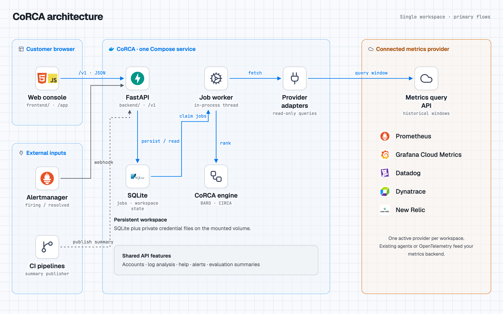

# CoRCA

CoRCA (Concurrent Root Cause Analysis) is a self-hosted investigation tool for
microservice incidents. It compares service metrics around an incident, uses
service dependencies to rank candidate causes, and shows the evidence that
remains unexplained.

**Status: beta.** Designed for one workspace, one application replica, and a
trusted team. Findings guide investigation; they are not confirmed causes or
automatic remediation. SSO, MFA, and tenant isolation are not included.

## What it does

- **Investigate incidents:** run metric-based diagnoses and review saved evidence.
- **Combine telemetry:** import metrics with OTLP logs and traces, inspect observed
  dependencies and model-based repair estimates, and assess candidate reliability
  from confirmed earlier outcomes. See [joint investigations](docs/guides/joint-diagnosis.md).
- **Receive alerts:** collect Alertmanager updates and link alerts to diagnoses.
- **Analyze log files:** find recurring patterns, explore counts over time, and
  download reports. No monitoring connection is required; uploads are not retained.
- **Review evaluations:** display published diagnosis, AI help, and software-check
  results with sample counts and provenance. Pipelines execute outside CoRCA.
- **Work as a team:** use local administrator/responder accounts and shared history.
  Bundled help works without an AI provider; generative answers are optional.

Monitoring adapters: **Prometheus, Grafana Cloud Metrics, Datadog, Dynatrace,
and New Relic**. OpenTelemetry can feed the connected metrics backend.

## Quick start

For a reproducible defense workspace and evaluation pipeline, follow the
[committee review guide](docs/guides/defense.md). It includes a short synthetic
walkthrough and full recorded-data evaluation with baseline comparisons.

Requires Git and a running Docker daemon with Docker Compose.

```sh
git clone https://github.com/Nagasai125/CoRCA.git
cd CoRCA
docker compose up -d --build --wait
```

Open [CoRCA](http://localhost:8000/app). Workspace data persists in a Docker volume.
No Kubernetes cluster or benchmark dataset is required.

A fresh installation uses shared administrator access and binds to localhost.
[Create named accounts](docs/guides/operations.md#individual-access) before sharing
access; use HTTPS for remote deployments.

```sh
docker compose logs -f corca  # Follow backend logs; Ctrl+C stops following.
docker compose down           # Stop the app and preserve workspace data.
```

`docker compose down -v` deletes the workspace volume.

## First investigation

1. Open **Settings → Connect & verify**, choose a provider, and verify its connection.
2. Open **Settings → Services & sensitivity**, discover services, select the scope, and save
   caller → dependency relationships. Confirm an empty graph for independent services.
3. Set investigation sensitivity for BARO, or load compatible calibration.
4. Choose **Start a diagnosis**, enter the incident start time, and review results.

For logs only, open **Log analysis** and upload a UTF-8 `.log`, `.txt`, `.jsonl`,
or `.ndjson` file up to **2 MiB**. Download the report to keep it.

See [telemetry setup](docs/guides/telemetry.md) for credentials, queries, and custom
hosts. Inside Docker, `localhost` is the container; host monitoring typically uses
`host.docker.internal`, allowed through `CORCA_ALLOWED_SOURCE_HOSTS`.

## Architecture

<picture>
  <source media="(prefers-color-scheme: dark)" srcset="docs/architecture/corca-stack-dark.png">
  
</picture>

FastAPI serves the frontend and API. Jobs persist in SQLite before the worker
claims them; the worker, provider adapters, and ranking engine run in one service.
Research and lab tools run separately. [Diagram source](docs/architecture/corca-stack-diagram.html).

## Repository layout

| Path | Responsibility |
| --- | --- |
| `frontend/` | Console, landing page, styles, JavaScript, fonts, and help content |
| `backend/` | FastAPI endpoints, authentication, adapters, storage, and operator commands |
| `corca/` | Shared diagnosis and ranking engine |
| `tests/` | Python and Node regression checks; application tests in `tests/backend/` |
| `e2e/` | Browser acceptance checks and synthetic provider fixtures |
| `lab/` | Isolated Kubernetes testbed and fault-collection tools |
| `scripts/` | Research experiments, benchmarks, calibration, and reporting |
| `docs/` | Current guides, API reference, architecture, and research procedures |

FastAPI serves the vanilla HTML/JavaScript frontend. SQLite stores workspace data.
The production package includes `frontend/`, `backend/`, and `corca/`; lab,
research, and test tools are excluded.

## Local development

Requires **Python 3.12**, **uv**, and **Node.js 22+** for console tests.

```sh
uv sync --frozen --extra dev --extra server
uv pip install --no-deps --require-hashes -r backend/rcaeval.lock
uv run --no-sync corca-serve
```

Open [the local console](http://localhost:8000/app). The frontend has no separate
build step. Run these checks before submitting changes:

```sh
OPENBLAS_NUM_THREADS=1 OMP_NUM_THREADS=1 uv run --no-sync python -m pytest -q
node --test tests/console-navigation.test.cjs tests/console-html.test.cjs
```

## Contributing

For bugs, include reproduction steps and expected/actual behavior. For pull
requests, keep the scope focused, explain the user impact, list checks run, and
update affected docs. Do not commit credentials, customer logs, databases, or
local experiment outputs.

[CONTRIBUTING.md](CONTRIBUTING.md) covers setup, review expectations, browser and
package checks, and the separation between application and research work.

## Documentation

- [Documentation index](docs/README.md) — find the guide for your task.
- [API reference](docs/api/README.md) and [OpenAPI schema](docs/api/openapi.json).
- [Operations](docs/guides/operations.md) — accounts, alerts, backups, and deployment.
- [Customer pilot checklist](docs/guides/pilot.md) — validate your target environment.
- [Changelog](CHANGELOG.md) — release and behavior changes.

## License

CoRCA's original code is licensed under the [MIT License](LICENSE). Bundled
fonts retain their [separate licenses](frontend/fonts/README.md).
